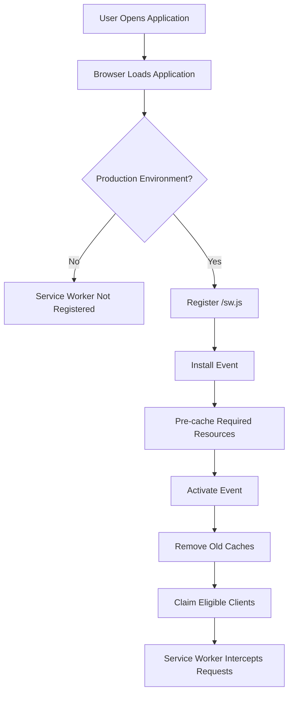
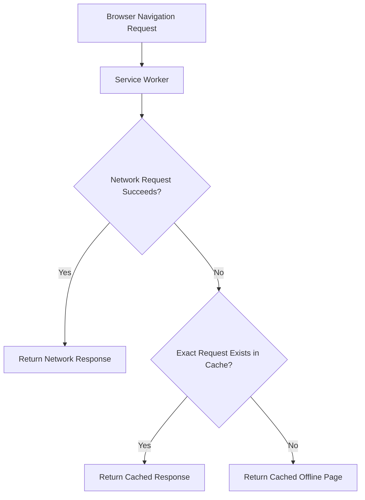
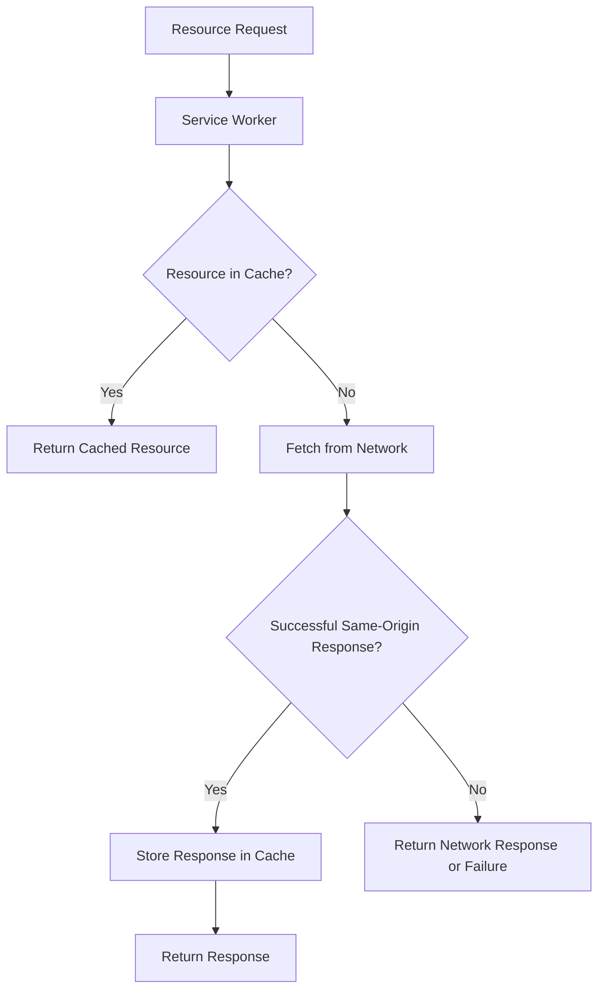
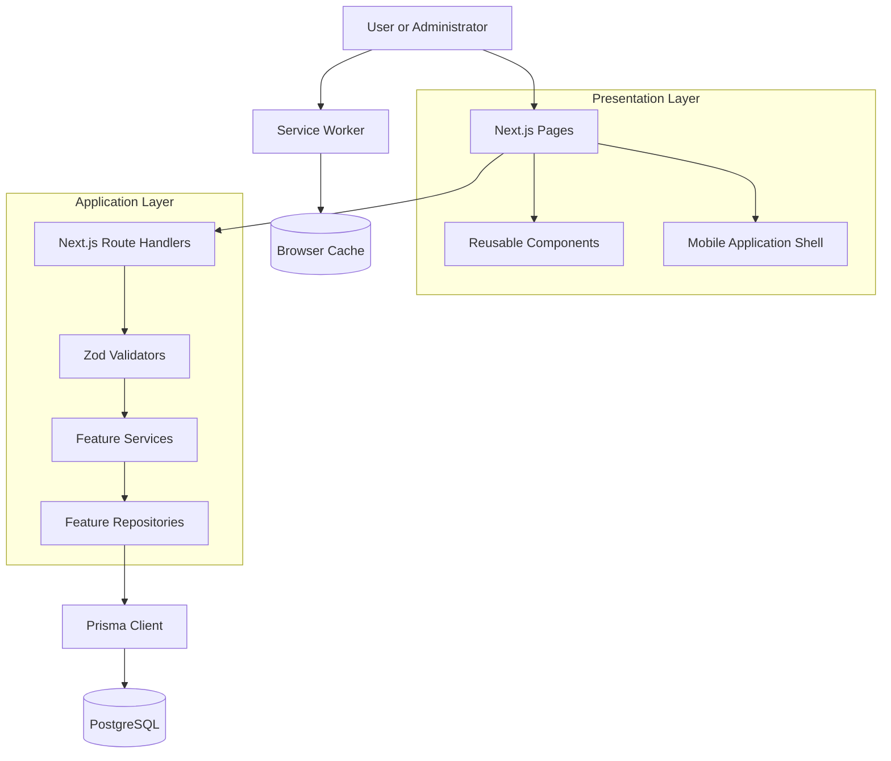
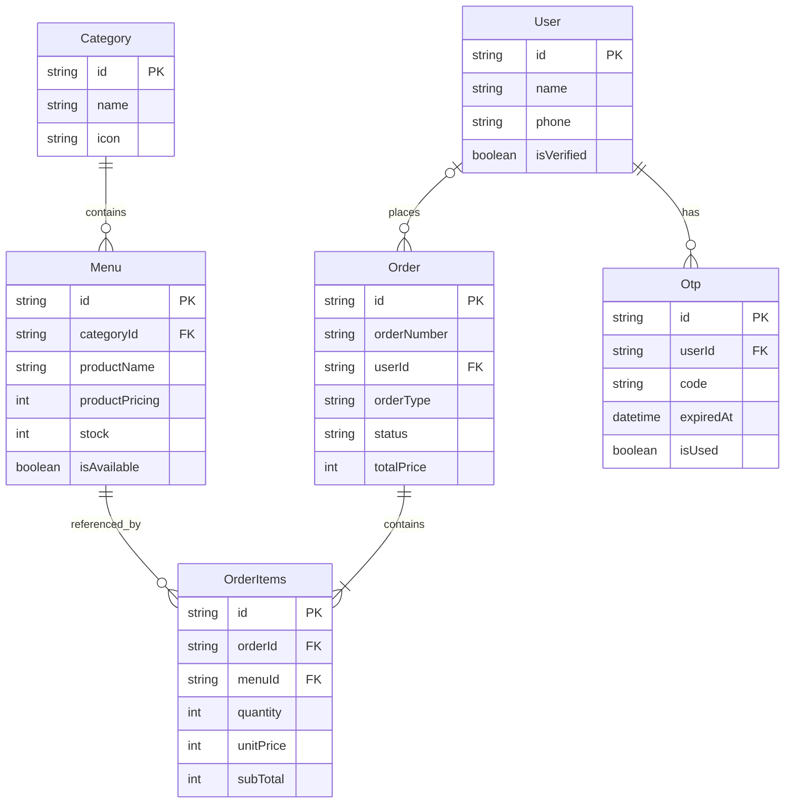
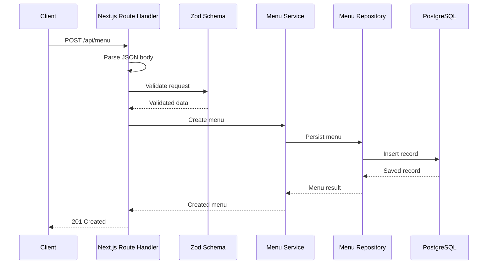
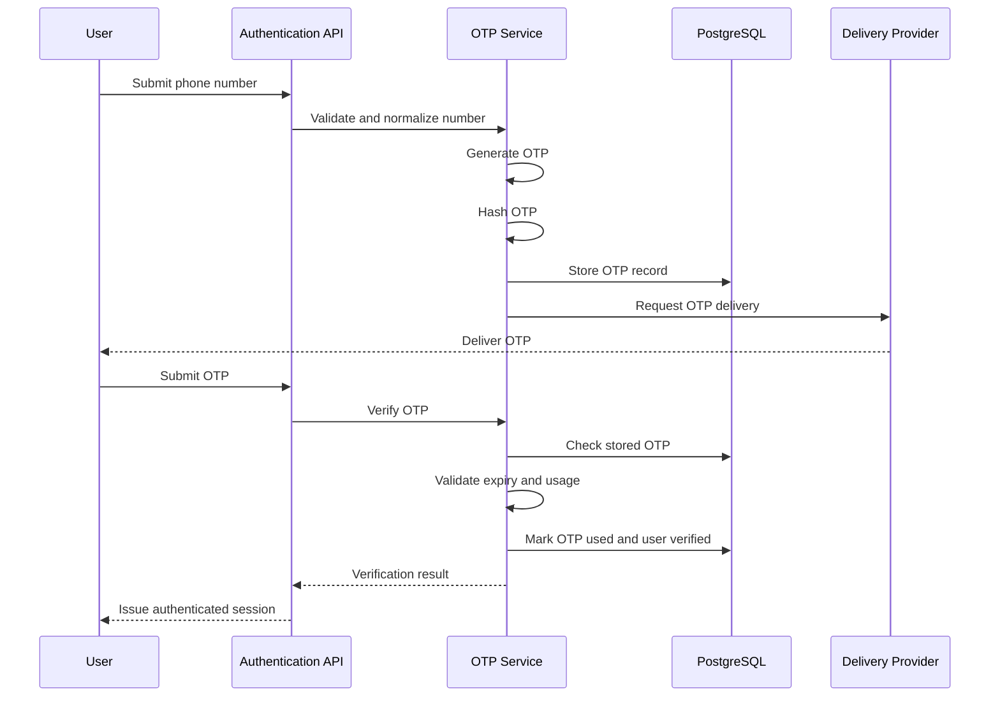

# ☕ COFFEE — Progressive Web App

A modern coffee shop web application built with **Next.js, React, TypeScript, PostgreSQL, and Prisma ORM**, with a focus on Progressive Web App (PWA) capabilities, responsive mobile-first design, and maintainable software architecture.

COFFEE is designed to provide a mobile-app-like experience through the browser, allowing users to explore coffee shop information, browse menus, and access the application through an installable web experience.

The project also explores industry-standard development practices, including feature-based architecture, separation of concerns, request validation, database abstraction, reusable UI components, and structured business logic.

## Table of Contents

- [Project Overview](#project-overview)
- [Core Objectives](#core-objectives)
- [Features](#features)
- [Technology Stack](#technology-stack)
- [PWA Architecture](#pwa-architecture)
- [PWA Lifecycle and Request Flow](#pwa-lifecycle-and-request-flow)
- [Application Architecture](#application-architecture)
- [Project Structure](#project-structure)
- [Database Design](#database-design)
- [API Architecture](#api-architecture)
- [Authentication Architecture](#authentication-architecture)
- [Responsive Design Strategy](#responsive-design-strategy)
- [Security and Industry Best Practices](#security-and-industry-best-practices)
- [Getting Started](#getting-started)
- [Environment Configuration](#environment-configuration)
- [Database Setup](#database-setup)
- [Running the Application](#running-the-application)
- [Testing and Code Quality](#testing-and-code-quality)
- [PWA Testing Checklist](#pwa-testing-checklist)
- [Current Implementation and Improvements](#current-implementation-and-improvements)
- [Roadmap](#roadmap)

---

## Project Overview

COFFEE is a coffee shop web application built with a mobile-first approach and an installable web experience.

Rather than treating the project as a conventional static website, the application uses Next.js to combine a responsive user interface, server-side API routes, database access, and PWA-related capabilities.

The application includes public-facing pages, menu browsing, administrative interfaces, menu and category management, and foundational authentication and ordering data models.

### Project Goals

The primary goals are:

- **PWA-first development:** build a web application that can be installed and launched like a mobile application.
- **Mobile-first user experience:** prioritize usability on mobile devices while maintaining a responsive layout on larger screens.
- **Maintainable architecture:** separate presentation, validation, business logic, persistence, and database concerns.
- **Type safety:** use TypeScript and structured data models to reduce avoidable runtime errors.
- **Database integrity:** use PostgreSQL, Prisma ORM, relational models, and database migrations.
- **Secure application design:** establish a foundation for authentication, input validation, and controlled access to administrative functionality.
- **Performance and reliability:** use caching, optimized assets, and appropriate offline behavior to improve the user experience.

The project is an evolving implementation. The architecture and roadmap distinguish existing code from features that still need additional implementation or verification.

---

## Core Objectives

### 1. Progressive Web App

The PWA layer provides the foundation for:

- Installable application behavior.
- A web app manifest.
- Application icons and theme configuration.
- Service worker registration.
- Caching of selected resources.
- Offline fallback navigation.
- Platform-specific installation guidance.

### 2. Feature-Based Architecture

Business features are organized into dedicated modules rather than putting all application logic into route handlers or UI components.

For example, menu management is organized into:

- Validators.
- Services.
- Repositories.
- API route handlers.

This makes responsibilities easier to understand and allows features to evolve independently.

### 3. Full-Stack TypeScript

TypeScript is used across the Next.js application, API routes, and business logic.

Prisma provides a typed interface for database operations, while Zod validates incoming data at runtime.

### 4. Mobile-First Application Experience

The interface includes a mobile application shell and bottom navigation.

The layout is designed around a constrained mobile viewport, with the goal of providing a consistent experience across different screen sizes.

---

## Features

### Public Website

- Home page with coffee shop content.
- About page.
- Menu browsing.
- Product and menu presentation.
- Gallery and promotional sections.
- Location information.
- WhatsApp-related contact prompt.

### Administrative Interface

- Administrative dashboard.
- Menu management interface.
- Category management interface.
- Reusable forms and modal components.

The existence of an administrative interface does not, by itself, guarantee that all routes are protected by server-side authorization. Access control should be implemented and verified separately.

### Menu and Category Management

The backend provides API endpoints for retrieving and creating menu and category records.

The application uses dedicated service and repository layers to separate request handling from business logic and persistence.

### Authentication Foundation

The repository includes authentication-related modules, an OTP service, phone-number normalization, and database models for users and OTP records.

The OTP utility generates numeric codes and supports hashing and comparison with `bcryptjs`.

A complete authentication flow must also enforce OTP expiration, one-time use, attempt limits, secure session issuance, and server-side authorization.

### Order Data Foundation

The Prisma schema includes data models for:

- Users.
- OTP records.
- Orders.
- Order items.
- Menu items.
- Categories.

It also defines order types and order statuses.

The repository includes an order-flow planning document. Planned ordering workflows should not be considered fully implemented solely because their data models and design notes exist.

---

## Technology Stack

| Category | Technology | Purpose |
|---|---|---|
| Framework | Next.js 16 | Application routing, rendering, and server-side API endpoints. |
| UI library | React 19 | Component-based user interface development. |
| Programming language | TypeScript 5 | Type safety and maintainable application code. |
| Styling | Tailwind CSS 4 | Utility-first styling and responsive layouts. |
| Database | PostgreSQL | Persistent relational data storage. |
| ORM | Prisma 7 | Typed database access and schema management. |
| PostgreSQL driver | `pg` | PostgreSQL connectivity. |
| Prisma adapter | `@prisma/adapter-pg` | Connects Prisma Client to the PostgreSQL driver adapter. |
| Request validation | Zod 4 | Runtime validation of API request data. |
| Password/OTP hashing | `bcryptjs` | Hashing and comparison of sensitive authentication codes. |
| Token utilities | `jose` | Provides cryptographic primitives for JWT and related token workflows when implemented. |
| Animation | Framer Motion | Motion and transition effects. |
| Icons | Lucide React and React Icons | Reusable interface icons. |
| Linting | ESLint 9 | Static analysis and code-quality checks. |
| PWA manifest | Web App Manifest | Defines application identity, icons, and installation display settings. |
| Offline and caching layer | Service Worker API | Intercepts requests and manages selected cached resources. |
| Development tooling | npm | Dependency management and project scripts. |

### Why This Stack?

**Next.js and React** provide the foundation for a component-driven full-stack web application.

**TypeScript** helps catch type-related errors during development and improves code navigation.

**PostgreSQL and Prisma** provide relational data persistence with explicit models, relationships, and migration support.

**Zod** validates untrusted request data at runtime instead of relying only on TypeScript types.

**Service workers and the Web App Manifest** provide browser-level capabilities needed for an installable PWA.

The stack is designed to balance developer productivity, maintainability, and the ability to evolve the application as its business requirements grow.

---

## PWA Architecture

A Progressive Web App combines web technologies with selected application-like capabilities.

In this project, PWA behavior is implemented through three primary components:

1. Web App Manifest.
2. Service worker.
3. Client-side service worker registration and installation guidance.

### 1. Web App Manifest

File: `public/manifest.json`

The manifest defines the application's identity and preferred presentation when installed.

The current manifest includes:

- Application name: `COFFEE - Digital Workspace & Coffee`.
- Short name: `COFFEE`.
- Start URL: `/`.
- Display mode: `standalone`.
- White background and theme colors.
- Portrait orientation preference.
- Application icons.
- Application categories.
- Root application scope.

The root layout references the manifest through Next.js metadata.

It also defines application icons and Apple web app metadata.

#### Why the Manifest Matters

The manifest allows compatible browsers to understand how the application should appear when launched from an installed application shortcut.

The `standalone` display mode requests an application-like window without the usual browser interface, where supported.

However, the manifest does not provide offline functionality by itself. Offline behavior depends on the service worker and the resources it successfully caches.

### 2. Service Worker

File: `public/sw.js`

The service worker implements the initial caching and offline fallback strategy.

Its current responsibilities include:

- Pre-caching selected static resources during installation.
- Activating the new service worker.
- Removing caches with names different from the current cache version.
- Claiming control of eligible pages.
- Intercepting navigation requests.
- Attempting to use a cached response when a navigation request fails.
- Returning the offline page as a navigation fallback.
- Caching successful same-origin responses for other intercepted requests.

The current cache name is:

```javascript
const CACHE_NAME = "kopkit-pwa-v1";
```

The initial asset list includes:

```javascript
const STATIC_ASSETS = [
  "/",
  "/manifest.json",
  "/offline",
  "/kopkit/LogoMain.png",
  "/kopkit/icon.webp",
  "/kopkit/logowhite.png"
];
```

These resources are cached during the service worker's installation phase.

If a required resource fails to load during `cache.addAll()`, the installation can fail. The precache list should therefore contain only resources that are expected to be available.

### 3. Service Worker Registration

File: `components/ui/mobileAppShell.tsx`

The mobile application shell registers the service worker from the client.

Registration is conditional:

```typescript
if (
  "serviceWorker" in navigator &&
  process.env.NODE_ENV === "production"
) {
  window.addEventListener("load", () => {
    navigator.serviceWorker
      .register("/sw.js")
      .then((reg) => {
        console.log(
          "COFFEE Service Worker registered with scope:",
          reg.scope
        );
      })
      .catch((err) => {
        console.error(
          "Service Worker registration failed:",
          err
        );
      });
  });
}
```

This means the service worker is registered only when the application runs in a production environment and the browser supports service workers.

Registering after the page load helps avoid interfering with the initial page load.

The application should be tested using a production build when validating service worker behavior.

### 4. Installation Prompt

File: `components/ui/installPrompt.tsx`

The installation component handles two installation experiences.

**Compatible browsers**

The component listens for the `beforeinstallprompt` event and can display an installation button when the browser provides that event.

**iOS Safari**

The component displays instructions for adding the application to the home screen.

The iOS prompt dismissal state is stored in local storage so the instructions are not repeatedly displayed after dismissal.

Installation behavior differs across browsers and operating systems. A custom installation prompt cannot guarantee that every browser will offer the same installation capability.

### 5. Offline Page

File: `app/offline/page.tsx`

The offline page provides a fallback interface when a navigation request cannot be completed and a suitable cached page is unavailable.

It includes:

- An offline indicator.
- A connection status message.
- A retry action.
- A navigation action back to the home page.

This provides a more controlled user experience than a generic browser network error.

It does not mean every application feature is available offline. Database operations and other server-dependent functionality still require a working connection unless explicit offline data and synchronization mechanisms are implemented.

---

## PWA Lifecycle and Request Flow

### Service Worker Lifecycle



The service worker is a separate browser-managed execution context. It can intercept eligible requests within its scope, but it does not replace the Next.js server or database.

### Navigation Request Flow

The current navigation strategy attempts the network first.



This strategy favors fresh server-rendered content when the network is available.

When the network fails, the service worker attempts to provide a cached page or the offline fallback.

A limitation of the current implementation is that the cache lookup uses the exact navigation request. A URL with a query string may not match the cached root URL. A production-ready implementation should normalize eligible navigation URLs and define explicit behavior for known application routes.

### Static Resource Request Flow

For non-navigation requests, the current service worker first checks the cache.



The current implementation caches successful same-origin responses, but it does not distinguish between immutable assets, frequently changing content, API responses, and sensitive information.

That distinction is important for correctness and security.

### Recommended Caching Strategy

A more robust production strategy should define caching behavior by resource type.

| Resource Type | Recommended Strategy | Reason |
|---|---|---|
| Versioned static assets | Cache-first | Assets can be reused without unnecessary network requests. |
| Application shell | Pre-cache or cache-first | Improves repeat visits and selected offline navigation. |
| Public menu data | Network-first with a controlled cache fallback | Prefers current menu data while allowing previously cached public data when appropriate. |
| Public images | Cache-first or stale-while-revalidate | Reduces repeated image downloads. |
| API mutations | Network-only | Create, update, and delete operations must not be silently treated as successful offline operations. |
| Authentication endpoints | Network-only | Avoids caching authentication responses and sensitive data. |
| User-specific information | Network-only by default | Prevents inappropriate reuse of private responses across sessions. |
| Administrative data | Network-only by default | Avoids stale privileged data being presented as current. |

These are recommendations for improving the existing service worker, not claims that every strategy has already been implemented.

---

## Application Architecture

The application uses a layered, feature-oriented architecture.

Its goal is to separate UI rendering, HTTP request handling, business logic, validation, and persistence.

### High-Level Architecture



The service worker is a browser-side component. It does not participate in the server-side business logic or database transaction flow.

### 1. Presentation Layer

Directory: `app/` and `components/`

Responsibilities:

- Render application pages.
- Display menus and categories.
- Provide administrative interfaces.
- Handle user interaction.
- Reuse UI components.
- Adapt layouts to different viewport sizes.

The App Router provides file-system-based routing.

### 2. API Layer

Directory: `app/api/`

Responsibilities:

- Expose HTTP endpoints.
- Parse incoming requests.
- Validate request bodies.
- Invoke feature services.
- Return JSON responses and appropriate HTTP status codes.

Route handlers should remain relatively thin. Business rules and database queries should not be duplicated across multiple endpoints.

### 3. Validation Layer

Directory: `features/*/validators/`

Zod schemas define the expected structure of incoming data.

For example, menu creation uses `CreatedMenuSchema` before calling the menu service.

Runtime validation is important because TypeScript types do not validate arbitrary JSON received over HTTP.

### 4. Service Layer

Directory: `features/*/service/`

Responsibilities:

- Implement business rules.
- Coordinate data operations.
- Enforce domain constraints.
- Orchestrate repository calls.

A service should not depend on UI components or browser-specific APIs.

### 5. Repository Layer

Directory: `features/*/repository/`

Responsibilities:

- Encapsulate database access.
- Provide operations required by business services.
- Separate persistence details from API handlers.
- Centralize commonly used data queries.

This separation helps make business logic easier to maintain and test.

### 6. Database Layer

Files: `prisma/schema.prisma` and `lib/db/index.ts`

PostgreSQL stores the application's persistent data.

Prisma provides the typed database client and schema management.

The Prisma client is initialized through a shared module, using a singleton pattern to reduce unnecessary client instances during development hot reloads.

---

## Project Structure

The following structure highlights the main application modules.

```text
CoffeeShop/
├── app/
│   ├── about/
│   │   └── page.tsx
│   ├── admins/
│   │   ├── categories/
│   │   │   └── page.tsx
│   │   ├── dashboard/
│   │   │   └── page.tsx
│   │   ├── menu/
│   │   │   └── page.tsx
│   │   ├── layout.tsx
│   │   └── page.tsx
│   ├── api/
│   │   ├── category/
│   │   │   ├── [id]/
│   │   │   │   └── route.ts
│   │   │   └── route.ts
│   │   └── menu/
│   │       ├── [id]/
│   │       │   └── route.ts
│   │       └── route.ts
│   ├── menu/
│   │   └── page.tsx
│   ├── offline/
│   │   └── page.tsx
│   ├── globals.css
│   ├── layout.tsx
│   └── page.tsx
│
├── components/
│   ├── about/
│   ├── menu/
│   ├── modal/
│   ├── sections/
│   └── ui/
│       ├── bottomNav.tsx
│       ├── installPrompt.tsx
│       ├── mobileAppShell.tsx
│       ├── navbar.tsx
│       ├── sidebar.tsx
│       └── whatsappPrompt.tsx
│
├── features/
│   ├── auth/
│   │   ├── repository/
│   │   ├── service/
│   │   ├── utils/
│   │   └── validators/
│   ├── category/
│   │   ├── repository/
│   │   ├── service/
│   │   └── validators/
│   └── menu/
│       ├── repository/
│       ├── service/
│       └── validators/
│
├── lib/
│   ├── data/
│   ├── db/
│   │   └── index.ts
│   ├── services/
│   ├── types/
│   └── validations/
│
├── prisma/
│   ├── migrations/
│   └── schema.prisma
│
├── public/
│   ├── fonts/
│   ├── kopkit/
│   ├── manifest.json
│   └── sw.js
│
├── next.config.ts
├── package.json
├── prisma.config.ts
├── tsconfig.json
└── README.md
```

### Directory Responsibilities

| Directory | Responsibility |
|---|---|
| `app/` | Application pages, layouts, and API route handlers. |
| `app/api/` | HTTP endpoints for server-side operations. |
| `components/` | Reusable presentation components. |
| `components/ui/` | Shared interface components and the mobile application shell. |
| `features/auth/` | Authentication-related validation, services, repositories, and utilities. |
| `features/category/` | Category business logic and persistence operations. |
| `features/menu/` | Menu business logic and persistence operations. |
| `lib/db/` | Shared database client initialization. |
| `lib/data/` | Structured data used by application components. |
| `lib/services/` | Shared application-level service utilities. |
| `lib/types/` | TypeScript interfaces and shared type definitions. |
| `lib/validations/` | Shared validation schemas. |
| `prisma/` | Database schema and migration history. |
| `public/` | Public assets, manifest, and service worker. |

### Why Feature-Based Architecture?

A feature-based structure groups related code by business capability.

For example, menu validation, menu services, and menu repositories live under `features/menu/`.

This is preferable to allowing each route handler to independently implement validation, business rules, and database queries.

As the application grows, the feature modules can be expanded without requiring all business logic to live in a single large directory.

---

## Database Design

The database schema is defined in `prisma/schema.prisma`.

The current schema includes the following models.

| Model | Purpose |
|---|---|
| `Menu` | Stores menu items, prices, stock, availability, and featured-item metadata. |
| `Category` | Groups menu items into categories. |
| `User` | Stores user identity and verification information. |
| `Otp` | Stores OTP records associated with users. |
| `Order` | Stores order information, customer details, type, status, and total price. |
| `OrderItems` | Stores individual menu items associated with an order. |

### Database Relationships



### Database Design Considerations

**Relational integrity**

Foreign keys connect menus to categories and order items to orders and menu items.

**Unique constraints**

The schema defines unique values for category names, user phone numbers, and order numbers.

**Explicit order status**

`OrderStatus` represents order progression through states such as `PENDING`, `CONFIRMED`, `PREPARING`, `READY`, `COMPLETED`, and `CANCELLED`.

**Historical pricing**

`OrderItems` stores `unitPrice` and `subTotal`, allowing an order to retain the price recorded when it was placed rather than relying exclusively on the menu's current price.

**Migration-based schema changes**

Database schema changes should be tracked through Prisma migrations instead of being applied manually without a migration history.

---

## API Architecture

The application uses Next.js Route Handlers to expose HTTP endpoints.

The existing menu and category route modules provide GET and POST operations.

### Menu API

| Method | Endpoint | Purpose |
|---|---|---|
| `GET` | `/api/menu` | Retrieve menu records. |
| `POST` | `/api/menu` | Create a menu record. |
| `GET` | `/api/menu/{id}` | Retrieve a menu record by ID, subject to handler implementation. |
| `PATCH` or `PUT` | `/api/menu/{id}` | Update a menu record, subject to handler implementation. |
| `DELETE` | `/api/menu/{id}` | Delete a menu record, subject to handler implementation. |

### Category API

| Method | Endpoint | Purpose |
|---|---|---|
| `GET` | `/api/category` | Retrieve category records. |
| `POST` | `/api/category` | Create a category record. |
| `GET` | `/api/category/{id}` | Retrieve a category record by ID, subject to handler implementation. |
| `PATCH` or `PUT` | `/api/category/{id}` | Update a category record, subject to handler implementation. |
| `DELETE` | `/api/category/{id}` | Delete a category record, subject to handler implementation. |

The exact methods supported by the individual `[id]/route.ts` files should be checked before relying on the full endpoint table.

### Example: Creating a Menu Item

The intended request flow is:

1. A client sends a POST request.
2. The route handler parses the JSON request body.
3. The Zod schema validates the input.
4. The menu service executes the business operation.
5. The menu repository performs the database operation through Prisma.
6. The route handler returns a JSON response.



This sequence describes the intended layered flow reflected by the existing menu API.

### API Design Recommendations

For a more robust production API:

- Validate all external input.
- Return consistent error-response structures.
- Distinguish validation failures from unexpected server errors.
- Use appropriate HTTP status codes.
- Avoid returning raw database errors to clients.
- Add pagination to endpoints that may return large collections.
- Protect mutation endpoints with authentication and authorization.
- Apply rate limiting to sensitive endpoints.
- Keep business logic out of UI components and route handlers.

---

## Authentication Architecture

The repository contains the foundation for a phone-number and OTP-based authentication flow.

Relevant code is organized under `features/auth/`.

### Existing Components

| Component | Responsibility |
|---|---|
| `auth.repository.ts` | Authentication-related data access. |
| `auth.service.ts` | Authentication service module. |
| `otp.service.ts` | OTP generation, hashing, and comparison utilities. |
| `auth.utils.ts` | Phone-number normalization. |
| `auth.validator.ts` | Authentication input validation. |

The OTP utility uses a cryptographically secure random-number generator and `bcryptjs` to hash and compare OTP values.

### Intended Authentication Flow



This is the intended flow for a secure OTP authentication system. The existence of the OTP utility alone does not establish that every step, including delivery, session creation, expiration enforcement, and authorization, is complete.

### Authentication Security Requirements

A production-ready OTP flow should:

- Store OTP hashes instead of plaintext codes.
- Enforce expiration.
- Allow each OTP to be used only once.
- Limit verification attempts.
- Rate-limit OTP generation and verification.
- Avoid revealing whether a phone number is registered.
- Use secure session cookies with `HttpOnly`, `Secure`, and an appropriate `SameSite` policy.
- Verify authentication and authorization on the server for protected operations.
- Avoid exposing OTP values, session tokens, or sensitive authentication details in logs.

The `jose` dependency can support token-related workflows, but the presence of that dependency does not by itself establish that a complete JWT authentication system is implemented.

---

## Responsive Design Strategy

The application follows a mobile-first layout approach.

The mobile application shell provides a centered content area with a maximum width, fixed bottom navigation, and shared interface elements.

The current implementation targets a mobile-app-like viewport and provides a desktop backdrop for larger screens.

### Responsive Design Principles

**Mobile-first**

Design the primary experience for smaller screens before extending the layout to tablets and desktops.

**Reusable components**

Navigation, buttons, modals, and other UI elements should be implemented as reusable components.

**Touch-friendly controls**

Interactive elements should have sufficient target sizes and spacing for touch input.

**Accessible navigation**

Navigation should provide meaningful labels, visible focus states, and keyboard-accessible controls.

**Performance-aware assets**

Images should use suitable dimensions and formats, with lazy loading where appropriate and optimized loading for above-the-fold content.

**Safe-area support**

The root viewport includes `viewport-fit=cover`. Fixed navigation and other edge-positioned elements should also account for safe-area insets on supported mobile devices.

---

## Security and Industry Best Practices

The project separates several important concerns, but a production-ready application requires additional controls.

### 1. Input Validation

Use Zod to validate all incoming data at runtime.

Validation should cover:

- Required fields.
- String lengths.
- Numeric ranges.
- Enum values.
- Email and phone formats.
- Related-record identifiers.
- Business constraints.

Validation should be performed on the server even when the frontend already validates the same data.

### 2. Authentication and Authorization

Authentication establishes who the user is. Authorization determines what that user is permitted to do.

Administrative routes and mutation endpoints must verify permissions on the server. Hiding
